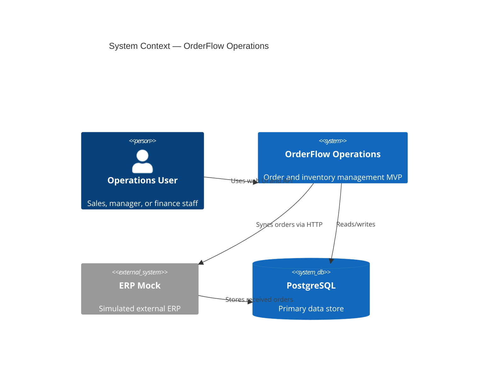
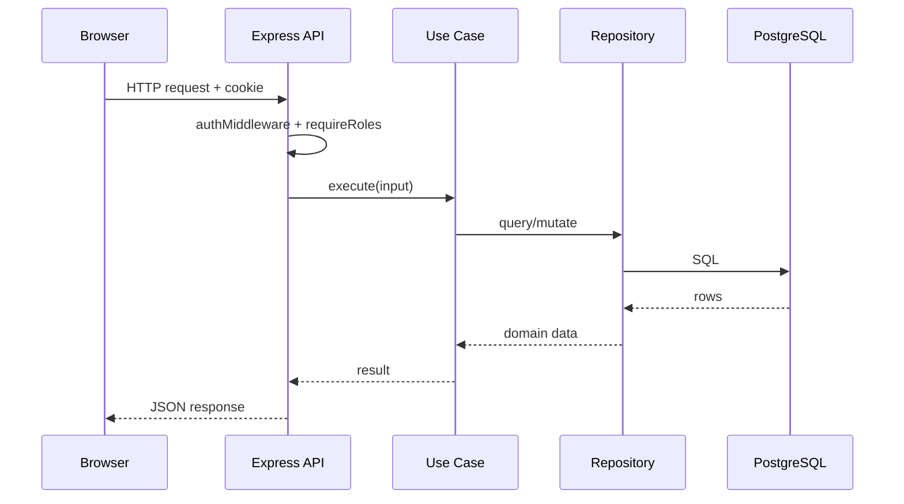
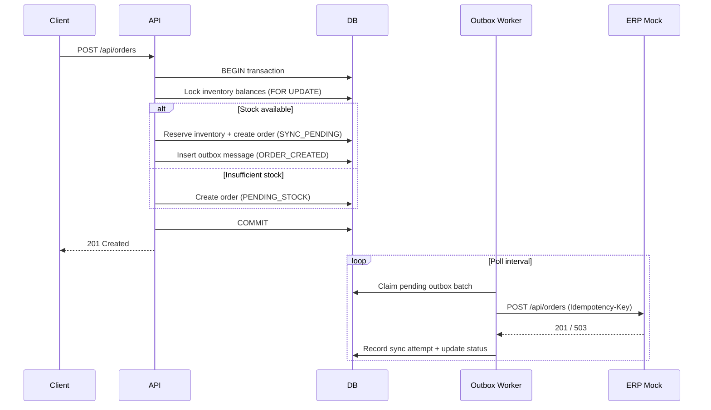
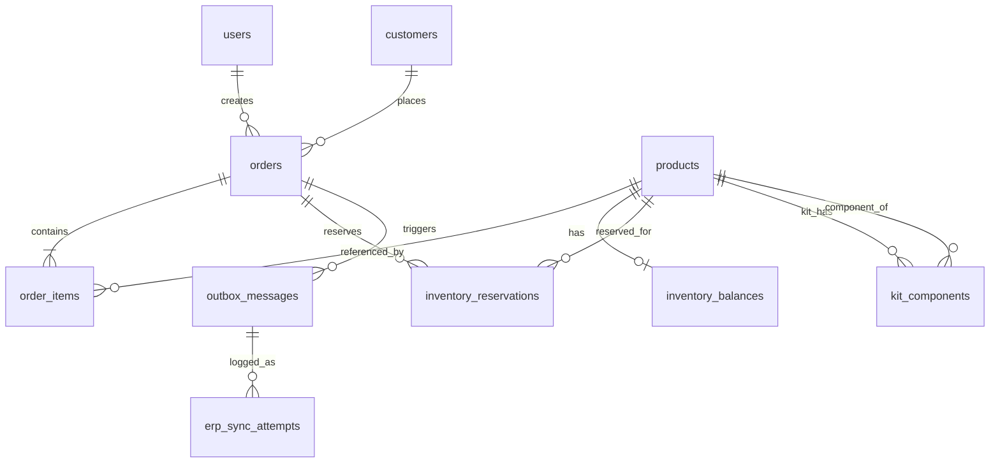

# Architecture

This document describes the high-level architecture of OrderFlow Operations as implemented in v0.1.0. It reflects the actual codebase structure and is not a production architecture blueprint.

## Architectural Style

OrderFlow is a **modular monolith**: a single deployable API process organized into domain modules with clear boundaries, without the operational complexity of microservices.

Each module follows a layered structure:

```
modules/<domain>/
├── http/           # Routes, controllers, mappers
├── application/    # Use cases (business orchestration)
├── domain/         # Pure domain logic (where applicable)
└── infrastructure/ # Repositories (PostgreSQL access)
```

Shared cross-cutting concerns live in `apps/api/src/shared/`:

- `database/` — connection pool, transactions
- `errors/` — typed application errors and Express error handler
- `logging/` — structured JSON logger
- `observability/` — correlation ID and request logging middleware
- `validation/` — Zod request validation helpers

## System Context



## Module Map

| Module         | Responsibility                      | Key Tables                                        |
| -------------- | ----------------------------------- | ------------------------------------------------- |
| `auth`         | Login, JWT cookies, role middleware | `users`                                           |
| `customers`    | Customer CRUD                       | `customers`                                       |
| `products`     | Product catalog, kit components     | `products`, `kit_components`                      |
| `inventory`    | Balances, adjustments, availability | `inventory_balances`                              |
| `orders`       | Order lifecycle, reservations       | `orders`, `order_items`, `inventory_reservations` |
| `integrations` | Outbox, sync attempts, manual retry | `outbox_messages`, `erp_sync_attempts`            |
| `dashboard`    | Aggregated operational metrics      | (read-only queries)                               |
| `audit`        | Entity audit trail                  | `audit_logs`                                      |

## Request Flow



## Order Creation Flow



## Shared Contracts Package

`@orderflow/contracts` is the single source of truth for:

- Domain enums (`OrderStatus`, `UserRole`, `ProductType`, …)
- Zod request/response schemas shared between API and web
- ERP payload schemas used by both API worker and ERP mock

This prevents schema drift between frontend validation and backend enforcement.

## Background Processing

The outbox worker runs in-process within the API server (`apps/api/src/workers/outbox-worker.ts`). It:

1. Polls `outbox_messages` on a configurable interval
2. Claims a batch within a transaction (`FOR UPDATE SKIP LOCKED` pattern)
3. Sends payloads to the ERP mock via `fetch`
4. Records each attempt in `erp_sync_attempts`
5. Updates order status and outbox message status

There is no separate message broker. This is intentional for MVP simplicity.

## Frontend Architecture

The web app (`@orderflow/web`) is a client-rendered SPA:

- **React Router** for navigation and protected routes
- **TanStack Query** for server state (where used)
- **React Hook Form + Zod** for form validation
- **CSS Modules** for component styling

The API client (`apps/web/src/api/client.ts`) sends requests with cookie credentials and correlation IDs.

## Data Model (Simplified)



## Design Decisions

Key architectural decisions are recorded as ADRs in [decisions/](decisions/):

| ADR                                                             | Topic                |
| --------------------------------------------------------------- | -------------------- |
| [0001](decisions/0001-modular-monolith.md)                      | Modular monolith     |
| [0002](decisions/0002-postgresql-as-primary-store.md)           | PostgreSQL           |
| [0003](decisions/0003-transactional-outbox-pattern.md)          | Transactional outbox |
| [0004](decisions/0004-shared-contracts-package.md)              | Shared contracts     |
| [0005](decisions/0005-jwt-cookie-authentication.md)             | JWT cookie auth      |
| [0006](decisions/0006-erp-mock-for-integration.md)              | ERP mock             |
| [0007](decisions/0007-vps-deployment-with-systemd-and-nginx.md) | VPS deployment       |

## Non-Goals (v0.1.0)

- Multi-tenant isolation
- Event sourcing or CQRS
- Separate worker process / queue infrastructure
- Real ERP connector (SAP, TOTVS, etc.)
- Mobile clients or public API
