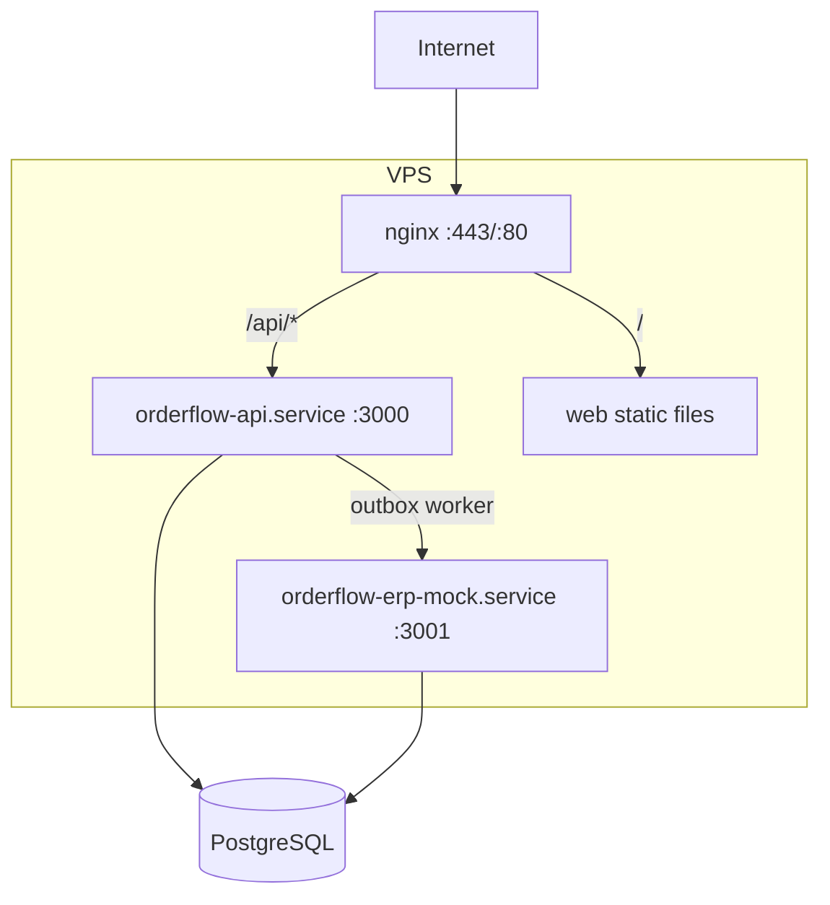

# VPS Deployment Guide

This guide covers deploying OrderFlow Operations to a Linux VPS using systemd, nginx, and PostgreSQL. This deployment model is suitable for demos and study environments — **not production workloads**.

## Architecture



## Prerequisites

- Ubuntu 22.04+ or Debian 12+ VPS
- PostgreSQL 16 (local or managed)
- Node.js 24.x
- nginx
- A domain name (optional, for TLS)
- SSH access with sudo privileges

## First-Time Installation

### 1. Prepare the server

```bash
# Install Node.js 24 (via nvm or NodeSource)
curl -fsSL https://deb.nodesource.com/setup_24.x | sudo -E bash -
sudo apt-get install -y nodejs nginx postgresql-client

# Create application user
sudo useradd --system --home /opt/orderflow --shell /usr/sbin/nologin orderflow
sudo mkdir -p /opt/orderflow /var/log/orderflow
sudo chown orderflow:orderflow /opt/orderflow /var/log/orderflow
```

### 2. Download and extract release

```bash
VERSION=0.1.0
curl -LO "https://github.com/luismpenholato/orderflow-operations/releases/download/v${VERSION}/orderflow-operations-v${VERSION}.tar.gz"
curl -LO "https://github.com/luismpenholato/orderflow-operations/releases/download/v${VERSION}/orderflow-operations-v${VERSION}.tar.gz.sha256"
sha256sum -c "orderflow-operations-v${VERSION}.tar.gz.sha256"

sudo tar -xzf "orderflow-operations-v${VERSION}.tar.gz" -C /opt/orderflow
sudo chown -R orderflow:orderflow /opt/orderflow/orderflow-operations-v${VERSION}
```

Or use the install script from a git checkout:

```bash
sudo bash deploy/install.sh
```

### 3. Configure environment

```bash
sudo cp deploy/.env.example /opt/orderflow/.env
sudo nano /opt/orderflow/.env
```

**Required changes for any non-local deployment:**

- Set a strong `JWT_SECRET`
- Set `DATABASE_URL` to your PostgreSQL instance
- Set `CORS_ORIGIN` to your public URL
- Set `NODE_ENV=production`
- Set `COOKIE_SECURE=true` (when using HTTPS)

### 4. Database setup

```bash
sudo -u orderflow bash -c 'cd /opt/orderflow/current && source /opt/orderflow/.env && npm run db:migrate'
# Optional: seed demo data (NOT recommended on shared servers)
# sudo -u orderflow bash -c 'cd /opt/orderflow/current && source /opt/orderflow/.env && npm run db:seed'
```

### 5. Install systemd services

```bash
sudo cp deploy/systemd/orderflow-api.service /etc/systemd/system/
sudo cp deploy/systemd/orderflow-erp-mock.service /etc/systemd/system/
sudo systemctl daemon-reload
sudo systemctl enable orderflow-api orderflow-erp-mock
sudo systemctl start orderflow-api orderflow-erp-mock
```

### 6. Configure nginx

```bash
sudo cp deploy/nginx/orderflow.conf /etc/nginx/sites-available/orderflow
sudo ln -sf /etc/nginx/sites-available/orderflow /etc/nginx/sites-enabled/
sudo nginx -t && sudo systemctl reload nginx
```

### 7. Verify

```bash
curl -s http://localhost/health | jq .
curl -s http://localhost/ready | jq .
sudo systemctl status orderflow-api orderflow-erp-mock
```

## Updating

Use the update script or GitHub Actions deploy workflow:

```bash
sudo bash deploy/update.sh v0.2.0
```

The update script:

1. Downloads and verifies the new release tarball
2. Extracts to `/opt/orderflow/orderflow-operations-vX.Y.Z`
3. Updates the `/opt/orderflow/current` symlink
4. Runs `npm ci --omit=dev` if needed
5. Runs database migrations
6. Restarts systemd services

## Rollback

If a deployment fails or introduces regressions, roll back to the previous release:

### 1. Identify the previous version

```bash
ls -la /opt/orderflow/
# Example: orderflow-operations-v0.1.0 still exists alongside v0.2.0
```

### 2. Switch the current symlink

```bash
PREVIOUS_VERSION=0.1.0
sudo ln -sfn "/opt/orderflow/orderflow-operations-v${PREVIOUS_VERSION}" /opt/orderflow/current
```

### 3. Restart services

```bash
sudo systemctl restart orderflow-api orderflow-erp-mock
sudo systemctl status orderflow-api orderflow-erp-mock
```

### 4. Verify health

```bash
curl -s http://localhost/health
curl -s http://localhost/ready
```

### 5. Database rollback (if needed)

Migrations are forward-only in v0.1.0. If a migration caused issues:

1. Restore PostgreSQL from a pre-deployment backup (recommended approach)
2. Or manually write and apply a reverse migration (not provided)

**Always take a database backup before updating:**

```bash
pg_dump "$DATABASE_URL" > /opt/orderflow/backups/pre-update-$(date +%Y%m%d).sql
```

### 6. Re-deploy via GitHub Actions

If deployed via `deploy-vps.yml`, re-run the workflow with the previous tag or use manual rollback steps above.

## Directory Layout

```
/opt/orderflow/
├── .env                          # Environment configuration
├── current -> orderflow-operations-v0.1.0/  # Symlink to active release
├── orderflow-operations-v0.1.0/  # Release directory
└── backups/                      # Database backups (create manually)
```

## Logs

```bash
# API logs
sudo journalctl -u orderflow-api -f

# ERP mock logs
sudo journalctl -u orderflow-erp-mock -f

# nginx access/error logs
sudo tail -f /var/log/nginx/orderflow-access.log
sudo tail -f /var/log/nginx/orderflow-error.log
```

## TLS (Recommended)

Use Certbot for Let's Encrypt certificates:

```bash
sudo apt install certbot python3-certbot-nginx
sudo certbot --nginx -d orderflow.example.com
```

Ensure `COOKIE_SECURE=true` after enabling HTTPS.

## Troubleshooting

| Symptom                      | Check                                                 |
| ---------------------------- | ----------------------------------------------------- |
| 502 Bad Gateway              | `systemctl status orderflow-api`, port 3000 listening |
| 503 on /ready                | PostgreSQL connectivity, `DATABASE_URL`               |
| Login fails                  | `JWT_SECRET`, `CORS_ORIGIN`, cookie secure flag       |
| Orders stuck in SYNC_PENDING | ERP mock running, `ERP_MOCK_URL`, outbox worker logs  |
| Static files 404             | nginx root path, web build in release tarball         |

## Security Notes

- Change all default secrets before exposing the server
- Do not run `db:seed` on public-facing servers (demo credentials)
- Restrict PostgreSQL to localhost or private network
- Keep Node.js and system packages updated
- Use firewall rules (ufw) to limit exposed ports to 80/443

## Related Files

- [deploy/install.sh](../../deploy/install.sh)
- [deploy/update.sh](../../deploy/update.sh)
- [deploy/.env.example](../../deploy/.env.example)
- [deploy/systemd/](../../deploy/systemd/)
- [deploy/nginx/orderflow.conf](../../deploy/nginx/orderflow.conf)
- [ADR 0007: VPS Deployment](../decisions/0007-vps-deployment-with-systemd-and-nginx.md)
