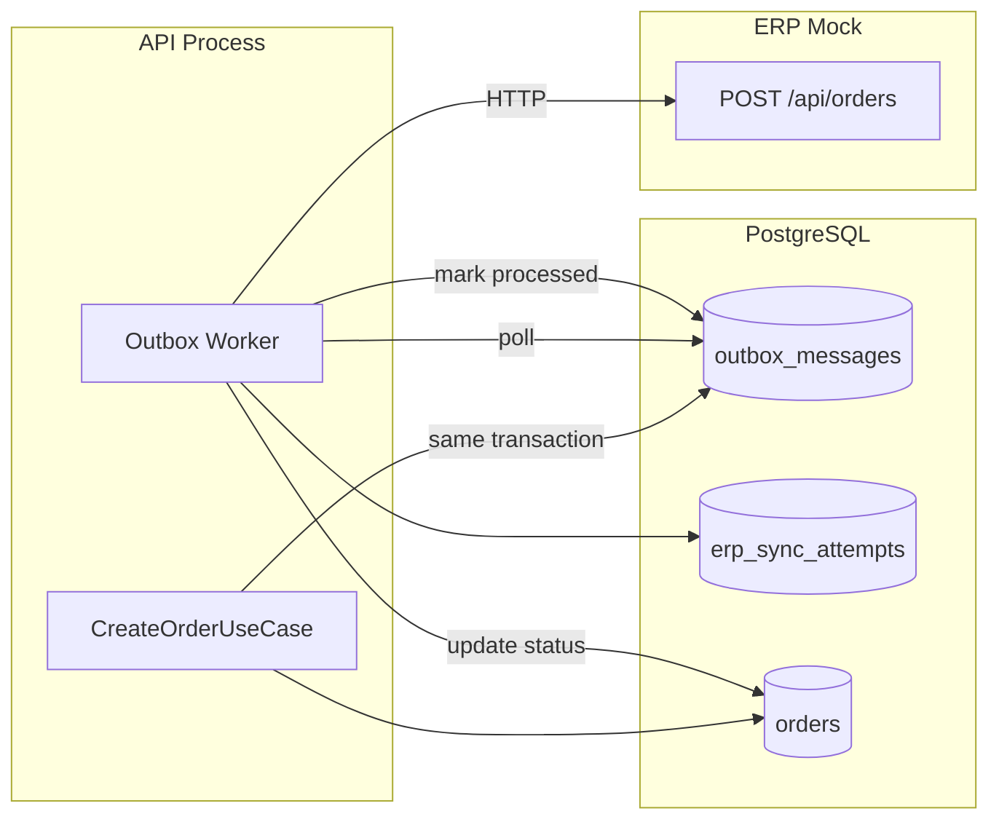

# ERP Synchronization

This document describes the asynchronous ERP integration in OrderFlow Operations, including the transactional outbox, sync attempts, retry behavior, and the ERP mock service.

## Overview

OrderFlow does not call the ERP synchronously during order creation. Instead, it writes an outbox message in the same database transaction as the order and inventory reservation. A background worker processes these messages asynchronously.



## Event Types

| Event             | Trigger                                   | Payload                             |
| ----------------- | ----------------------------------------- | ----------------------------------- |
| `ORDER_CREATED`   | Order created with full stock reservation | Order details, customer, line items |
| `ORDER_CANCELLED` | Manager cancels a reserved/syncing order  | Order ID, number, customer ID       |

Defined in `@orderflow/contracts` (`IntegrationEventType`).

## Outbox Message Lifecycle

| Status       | Meaning                       |
| ------------ | ----------------------------- |
| `PENDING`    | Awaiting processing           |
| `PROCESSING` | Claimed by worker (transient) |
| `PROCESSED`  | Successfully delivered to ERP |
| `FAILED`     | Max retries exhausted         |

Worker configuration (via environment):

| Variable                  | Default | Description                |
| ------------------------- | ------- | -------------------------- |
| `OUTBOX_POLL_INTERVAL_MS` | `5000`  | Poll frequency             |
| `OUTBOX_BATCH_SIZE`       | `10`    | Messages per poll          |
| `OUTBOX_MAX_RETRIES`      | `5`     | Max attempts before FAILED |

## Sync Attempts

Every delivery attempt is recorded in `erp_sync_attempts`:

- `attempt_number` — incremented per try
- `status` — `SUCCESS` or `FAILURE`
- `http_status` — ERP HTTP response code (0 for network errors)
- `error_message` — response body or network error
- `idempotency_key` — format: `erp-sync-{outboxId}-{attemptNumber}`

This provides a full audit trail visible in the Integration Monitor UI and via `GET /api/integrations/attempts`.

## Order Status Transitions

| Outcome                             | Order Status         |
| ----------------------------------- | -------------------- |
| Order created, stock reserved       | `SYNC_PENDING`       |
| ERP sync succeeds                   | `SYNCED`             |
| ERP sync fails, retries remain      | stays `SYNC_PENDING` |
| ERP sync fails, max retries reached | `SYNC_FAILED`        |

## Idempotency

Both the outbox worker and ERP mock enforce idempotency:

- **Worker** sends `Idempotency-Key` header on every ERP request
- **ERP mock** stores idempotency keys and returns the same response for duplicate keys

Order creation also supports client-side idempotency via the `Idempotency-Key` request header on `POST /api/orders`.

## ERP Mock Service

The `@orderflow/erp-mock` app simulates an external ERP:

| Endpoint              | Description                                       |
| --------------------- | ------------------------------------------------- |
| `GET /health`         | Health check with DB status                       |
| `POST /api/orders`    | Accept order payload (requires `Idempotency-Key`) |
| `GET /api/orders`     | List received orders                              |
| `GET /api/orders/:id` | Get order by ID                                   |

Failure simulation: set `ERP_MOCK_FAILURE_RATE` (0.0–1.0) to randomly return HTTP 503. Useful for testing retry and `SYNC_FAILED` states.

ERP orders are stored in a separate schema (`scripts/migrations/002_erp_mock_schema.sql`).

## Manual Retry

Managers can retry failed outbox messages:

```
POST /api/integrations/outbox/:id/retry
```

This resets the message to `PENDING` for reprocessing by the worker.

## ERP Payload Schema

Validated by `erpOrderPayloadSchema` in `@orderflow/contracts`:

```json
{
  "orderId": "uuid",
  "orderNumber": "ORD-000001",
  "customerId": "uuid",
  "customerName": "Northwind Trading Co.",
  "type": "SALE",
  "totalAmount": 89.97,
  "items": [
    {
      "productId": "uuid",
      "sku": "WIDGET-A",
      "name": "Standard Widget A",
      "quantity": 3,
      "unitPrice": 29.99
    }
  ]
}
```

## Monitoring

The web UI Integration Monitor page (`/integrations`) displays:

- Outbox message queue with status filters
- Sync attempt history
- Manual retry action for failed messages

API endpoints (MANAGER role):

- `GET /api/integrations/outbox`
- `GET /api/integrations/attempts`
- `POST /api/integrations/outbox/:id/retry`

## Limitations

- Worker runs in-process (stops when API stops)
- No dead-letter queue beyond `FAILED` status
- Cancellation outbox messages are created but cancellation delivery to ERP uses the same generic send path
- No circuit breaker or exponential backoff (fixed poll interval with retry count)

## Related Documentation

- [Architecture](architecture.md)
- [Inventory Reservation](inventory-reservation.md)
- [ADR 0003: Transactional Outbox](decisions/0003-transactional-outbox-pattern.md)
- [ADR 0006: ERP Mock](decisions/0006-erp-mock-for-integration.md)
