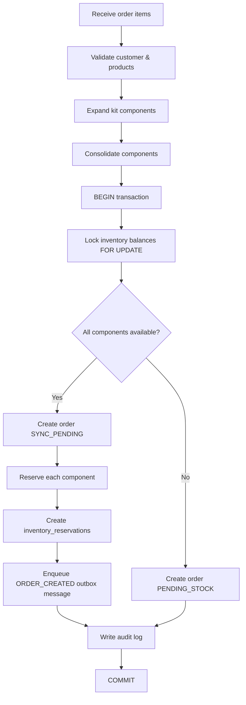

# Inventory Reservation

This document explains how OrderFlow Operations manages inventory balances, kit expansion, and stock reservations during order creation and cancellation.

## Concepts

| Term            | Definition                                                                       |
| --------------- | -------------------------------------------------------------------------------- |
| **On-hand**     | Physical quantity recorded in `inventory_balances.on_hand_quantity`              |
| **Reserved**    | Quantity allocated to active orders in `inventory_balances.reserved_quantity`    |
| **Available**   | `on_hand - reserved` (computed, never stored)                                    |
| **Reservation** | Row in `inventory_reservations` linking an order to a component product quantity |

Database constraint: `reserved_quantity <= on_hand_quantity` on `inventory_balances`.

## Availability Calculation

```typescript
// apps/api/src/modules/inventory/domain/inventory-calculations.ts
available = onHand - reserved;
```

Kit availability is derived from component availability:

```typescript
kitAvailable = min(floor(componentAvailable / componentQty)) for each component
```

## Kit Expansion

When an order contains kit products, components are expanded before stock checks:

1. **Expand** — Each kit line item is replaced by its component products multiplied by line quantity
2. **Consolidate** — Duplicate component product IDs are summed
3. **Lock & check** — Component balances are locked (`FOR UPDATE`) and availability is verified

Example: ordering 2× `STARTER-KIT` (1× WIDGET-A, 2× CABLE-01, 1× BRACKET-X per kit) requires:

- WIDGET-A: 2
- CABLE-01: 4
- BRACKET-X: 2

Implementation: `expandKitComponents()` and `consolidateComponents()` in `inventory-calculations.ts`.

## Order Creation Logic



Key behaviors:

- Reservations are always at the **component** level, not the kit level
- Order line items store the original products (kits or simple) as ordered
- `PENDING_STOCK` orders have **no** reservations and **no** outbox message
- Idempotency key support prevents duplicate orders on retry

Source: `CreateOrderUseCase` in `apps/api/src/modules/orders/application/create-order.use-case.ts`.

## Order Cancellation

When a manager cancels an order:

1. Order row is locked (`FOR UPDATE`)
2. Status must be cancellable: `RESERVED`, `SYNC_PENDING`, or `SYNC_FAILED`
3. Active reservations are released (decrement `reserved_quantity`, set `released_at`)
4. Order status → `CANCELLED`
5. If previous status was not `PENDING_STOCK`, an `ORDER_CANCELLED` outbox message is created

Source: `CancelOrderUseCase` in `apps/api/src/modules/orders/application/cancel-order.use-case.ts`.

## Manual Inventory Adjustments

Managers can adjust on-hand quantities via:

```
POST /api/inventory/:productId/adjustments
{ "quantityDelta": 50, "reason": "Stock receipt" }
```

Adjustments update `on_hand_quantity` directly. They do not automatically fulfill `PENDING_STOCK` orders — that would require a separate fulfillment workflow (not implemented in v0.1.0).

## Concurrency

Stock checks and reservations happen within a single database transaction with row-level locks on affected `inventory_balances` rows. This prevents overselling under concurrent order creation for the same products.

## Seed Data Example

The seed script creates `WIDGET-A` with only 5 on-hand units (others have 100) to demonstrate low-stock scenarios and kit constraints. See `scripts/seed.js`.

## Related Documentation

- [Architecture](architecture.md)
- [ERP Synchronization](erp-synchronization.md)
- [ADR 0003: Transactional Outbox](decisions/0003-transactional-outbox-pattern.md)
